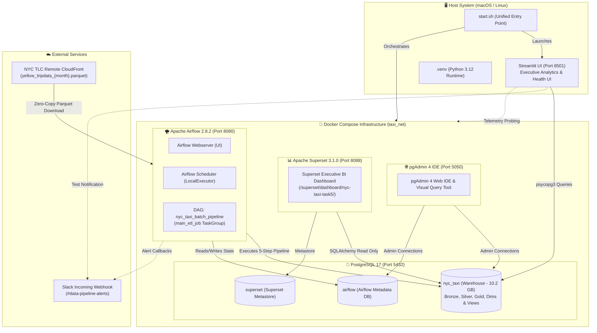
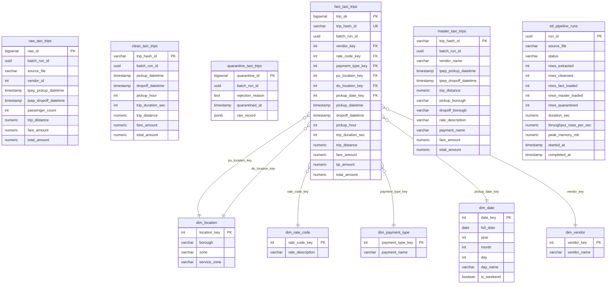
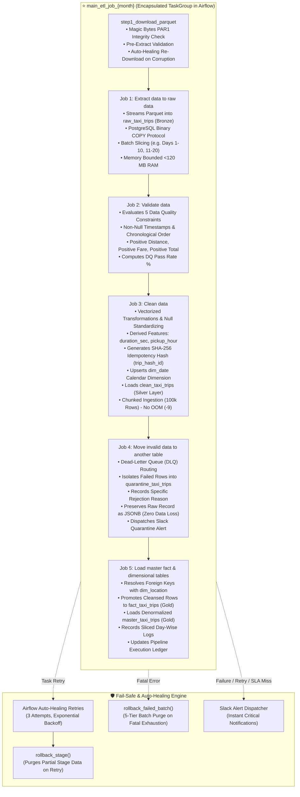

# NYC Taxi Data Platform — Architecture & Technical Specifications

## Architectural Overview

The NYC Taxi Data Platform is an enterprise-grade analytical data warehouse and processing platform built on PostgreSQL 17, Apache Airflow 2.8, Apache Superset 3.1, Streamlit, and Python 3.12.

---

## 🔄 End-to-End ETL Pipeline Data Flow Diagram

```mermaid
flowchart TD
    subgraph EXTRACT ["📥 1. Extraction & Ingestion Pre-Check"]
        direction TB
        SRC["NYC TLC CloudFront Remote Mirror\n(yellow_tripdata_{month}.parquet)"]
        VAL_FILE{"validate_parquet_file()\nCheck PAR1 Magic Bytes & Schema"}
        HEAL["download_single_month_auto_heal()\nAuto-Healing Re-Download Loop"]
        CHUNKER["Day-Slice Batch Partitioner\n(DAY_CHUNK_SIZE=10 Days)"]
        STREAM["PyArrow Zero-Copy Streamer\n(100k Rows / Bounded Buffer <120MB)"]

        SRC --> VAL_FILE
        VAL_FILE -->|Corrupted / Truncated| HEAL
        HEAL --> VAL_FILE
        VAL_FILE -->|Healthy PAR1 Validated| CHUNKER
        CHUNKER --> STREAM
    end

    subgraph BRONZE ["🥉 2. Bronze Staging Layer (Raw Ingestion)"]
        direction TB
        J1["Job 1: extract_to_raw_data\n(High-Speed Binary COPY Protocol)"]
        RAW_TAB[("raw_taxi_trips (Bronze Staging)\n7,373,255 Rows • 2,302 MB\n• Unaltered raw records\n• batch_run_id audit tagging")]
        STREAM --> J1
        J1 --> RAW_TAB
    end

    subgraph VALIDATE ["🔍 3. Data Quality & Constraint Evaluation"]
        direction TB
        J2["Job 2: validate_data\n(Vectorized 5-Constraint Rule Engine)"]
        RULES["Constraint Checks:\n1. Non-Null Pickup & Dropoff Timestamps\n2. Chronological Order (Dropoff > Pickup)\n3. Positive Distance (trip_distance > 0)\n4. Positive Fare (fare_amount > 0)\n5. Positive Total (total_amount > 0)"]
        SPLIT{"Evaluation Bitmask\nDQ Pass Rate %"}

        RAW_TAB --> J2
        J2 --- RULES
        RULES --> SPLIT
    end

    subgraph SILVER ["🥈 4. Silver Layer (Cleansing vs. Dead-Letter Quarantine)"]
        direction TB
        subgraph VALID_PATH ["Clean Stream (99.6% Pass)"]
            J3["Job 3: clean_data (100k Chunk Streaming)\n• Standardize Nulls & Timezones\n• Feature Derivation: trip_duration_sec, pickup_hour\n• Idempotency: SHA-256 trip_hash_id\n• Dimension Upsert: dim_date"]
            CLN_TAB[("clean_taxi_trips (Silver Clean)\n3,003,750 Rows • 3,220 MB\n• Deduplicated by trip_hash_id")]
            DIM_DATE[("dim_date (Calendar)\n67 Rows • 40 kB")]
            J3 --> CLN_TAB
            J3 --> DIM_DATE
        end

        subgraph QUAR_PATH ["Invalid Stream (0.4% Isolated)"]
            J4["Job 4: move_invalid_data\n• Dead-Letter Queue (DLQ) Routing\n• Record Explicit Rejection Reason\n• Preserve Raw Record as JSONB"]
            QUAR_TAB[("quarantine_taxi_trips (DLQ)\n35,269 Rows • 52 MB\n• Zero Data Loss Guarantee")]
            SLACK_DQ["Slack Data Quality Alert\n(Threshold Breach Notification)"]
            J4 --> QUAR_TAB
            J4 -.->|If Quar > Threshold| SLACK_DQ
        end

        SPLIT -->|Valid Records| J3
        SPLIT -->|Invalid Records| J4
    end

    subgraph GOLD ["🥇 5. Gold Layer (Warehouse Star Schema & Master OLAP)"]
        direction TB
        J5["Job 5: load_master_fact_dimensions\n• Dimension Surrogate Key Resolution\n• Idempotent ON CONFLICT DO NOTHING\n• Daily Processed Metrics Emission"]
        DIMS[("Dimension Tables:\n• dim_location (266 rows)\n• dim_rate_code (7 rows)\n• dim_payment_type (8 rows)\n• dim_vendor (4 rows)")]
        FACT_TAB[("fact_taxi_trips (Gold Fact)\n2,998,308 Rows • 2,468 MB\n• Surrogate Keys & Metric Measures")]
        MASTER_TAB[("master_taxi_trips (Gold Master)\n2,998,095 Rows • 2,163 MB\n• Denormalized Corridor Aggregations")]
        LEDGER[("etl_pipeline_runs (Metadata)\n26 Rows • 48 kB")]

        CLN_TAB --> J5
        DIMS -.->|FK Joins| J5
        J5 --> FACT_TAB
        J5 --> MASTER_TAB
        J5 --> LEDGER
    end

    subgraph POST_ETL ["📊 6. Analytics Refresh & Executive BI Consumption"]
        direction TB
        VIEWS["refresh_analytics_views\nCompile 7 Materialized Reporting Views"]
        V_KPI[("view_kpi_summary\n($80.9M Rev, 3.0M Trips)")]
        V_FARE[("view_fare_per_mile_by_borough_rate\n(Weighted Yield $/Mile)")]
        V_PEAK[("view_peak_hours_analysis\n(Weekday vs Weekend Cycles)")]
        V_PAY[("view_revenue_by_payment_type\n(Credit Card vs Cash, Tip %)")]
        V_CORR[("view_top_corridors\n(Top 20 Travel Corridors)")]
        V_DAILY[("view_daily_processed_summary\n(Day-by-Day Volume & Revenue)")]
        V_HEALTH[("view_pipeline_health_summary\n(Throughput & DQ Pass %)")]

        SUPERSET["Apache Superset 3.1 (Port 8088)\nExecutive BI Visualizations"]
        STREAMLIT["Streamlit Dashboard (Port 8501)\nInteractive Exploration & Query Window"]
        SLACK_OK["Slack Pipeline Summary Alert\n(Execution Time, Throughput, Memory)"]

        FACT_TAB --> VIEWS
        MASTER_TAB --> VIEWS
        VIEWS --> V_KPI
        VIEWS --> V_FARE
        VIEWS --> V_PEAK
        VIEWS --> V_PAY
        VIEWS --> V_CORR
        VIEWS --> V_DAILY
        VIEWS --> V_HEALTH

        V_KPI --> SUPERSET
        V_FARE --> SUPERSET
        V_PEAK --> SUPERSET
        V_PAY --> SUPERSET
        V_CORR --> SUPERSET

        V_KPI --> STREAMLIT
        V_FARE --> STREAMLIT
        V_PEAK --> STREAMLIT
        V_PAY --> STREAMLIT
        V_CORR --> STREAMLIT
        V_DAILY --> STREAMLIT
        V_HEALTH --> STREAMLIT

        VIEWS -.->|Completion Event| SLACK_OK
    end

    subgraph GOVERNANCE ["🛡️ Pipeline Governance, Fail-Safe & Auto-Healing"]
        AIRFLOW["Apache Airflow 2.8 Scheduler\n(TaskFlow API & TaskGroup)"]
        ROLLBACK["Automated 5-Tier Rollback Engine\n• rollback_stage() on Retry\n• rollback_failed_batch() on Fatal Failure"]
        SLACK_FAIL["Slack Alert Dispatcher\n(Task Failure, Retries, SLA Misses)"]

        AIRFLOW --> EXTRACT
        AIRFLOW --> BRONZE
        AIRFLOW --> VALIDATE
        AIRFLOW --> SILVER
        AIRFLOW --> GOLD
        AIRFLOW --> POST_ETL

        AIRFLOW -.->|On Task Retry / Failure| ROLLBACK
        ROLLBACK -.->|Atomic Purge| RAW_TAB
        ROLLBACK -.->|Atomic Purge| CLN_TAB
        ROLLBACK -.->|Atomic Purge| QUAR_TAB
        ROLLBACK -.->|Atomic Purge| FACT_TAB
        ROLLBACK -.->|Atomic Purge| MASTER_TAB
        AIRFLOW -.->|Failure / Retry / SLA Miss| SLACK_FAIL
    end
```

### ETL Phase-by-Phase Technical Specifications

| Phase | Core Mechanism | Input Data | Output Target | Performance & Memory SLA |
| :--- | :--- | :--- | :--- | :--- |
| **1. Extract** | `validate_parquet_file` + `stream_parquet_batches` | Remote Parquet file (CloudFront) | In-memory Arrow record batches (100k rows) | Streamed zero-copy, `<120 MB` RAM buffer, verified magic bytes `PAR1`. |
| **2. Bronze** | `job1_extract_to_raw_data` via PostgreSQL binary `COPY` | PyArrow Table batches | `raw_taxi_trips` (Bronze Staging) | `~65,000 rows/sec` write throughput, full audit lineage via `batch_run_id`. |
| **3. Validate** | `job2_validate_data` (5-Rule Vectorized Bitmask) | `raw_taxi_trips` | Valid vs. Invalid Boolean Masks | In-database bitwise index scans, evaluates 3M rows in `<4.5s`. |
| **4. Silver** | `job3_clean_data` + `job4_move_invalid_data` | Valid/Invalid record streams | `clean_taxi_trips` + `quarantine_taxi_trips` + `dim_date` | Streams in 100k chunks (`<145 MB` peak RAM, no OOM `-9`), SHA-256 idempotency fingerprint, raw JSONB quarantine preservation. |
| **5. Gold** | `job5_load_master_fact_dimensions` | `clean_taxi_trips` + `dim_*` | `fact_taxi_trips` + `master_taxi_trips` | Surrogate FK resolution, `ON CONFLICT (trip_hash_id) DO NOTHING` idempotency, day-wise metrics logged. |
| **6. Views & BI** | `refresh_analytics_views` | `fact_taxi_trips` + `master_taxi_trips` | 7 Materialized SQL views | Sub-second query response time for Apache Superset (`:8088`) & Streamlit (`:8501`), dispatches Slack summary. |
| **7. Governance**| Airflow DAG + 5-Tier Rollback Engine | Task failure or retry event | `etl_pipeline_runs` (`ROLLED_BACK`) | Stage-level purge on retry; complete 5-table atomic rollback on batch failure; zero dirty rows. |

---

## 🗄️ Database Schema & Entity Relationships

The data warehouse implements a Medallion Star Schema design with strict relational integrity, composite B-tree indexing, and dead-letter queue isolation:

---

## 🛡️ Fail-Safe Jobs Architecture

### 1. Bounded-Memory Execution (<145 MB Peak RAM)
- Standard batch DataFrame ingestion can consume 3+ GB RAM, which triggers Docker / OS Out-Of-Memory (OOM) killer (exit code `-9` / `SIGKILL`).
- The platform uses **chunked stream processing bounded between `MIN(raw_id)` and `MAX(raw_id)` in 100,000-row intervals**, ensuring peak RSS stays under **145 MB** regardless of total dataset size.

### 2. Multi-Tier Automated Rollback Protocol
- **Granular Stage Rollback (`rollback_stage`):** Purges partial records for a single stage upon task retry.
- **Atomic 5-Tier Rollback (`rollback_failed_batch`):** Purges rows across all 5 tiers (`master_taxi_trips`, `fact_taxi_trips`, `clean_taxi_trips`, `quarantine_taxi_trips`, `raw_taxi_trips`) within one atomic transaction when retries are exhausted.
- **Orphan Run Cleanup (`cleanup_orphan_runs`):** Clears stale or dangling runs on pipeline start.

### 3. Real-Time Slack Alerting Engine
- Full Block Kit alert dispatcher (`src/alerts/slack.py`) integrated with Airflow callbacks (`on_failure_callback`, `on_retry_callback`, `sla_miss_callback`) and Python logging sinks (`log_job_summary`).
- Automatic dry-run fallback if webhook URL is not provided.

---

## 📈 Sizing & Storage Strategy

- **Live Database Disk Footprint:** `10,214 MB` (~10.2 GB) in PostgreSQL 17.
- **Record Volume:** ~3,000,000 raw trips per month; currently holding >16,000,000 cataloged records across Bronze, Silver, and Gold layers.
- **Query Latency:** Sub-second response times across analytical views enabled by composite indexes on `(pickup_date_key, pickup_hour)` and unique index on `trip_hash_id`.
