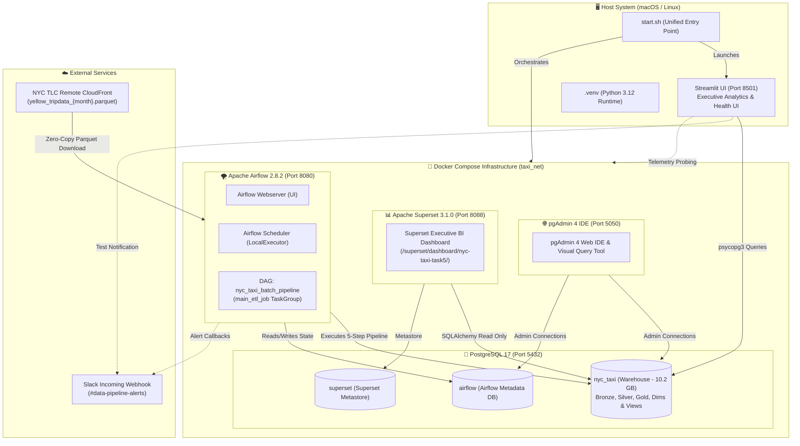
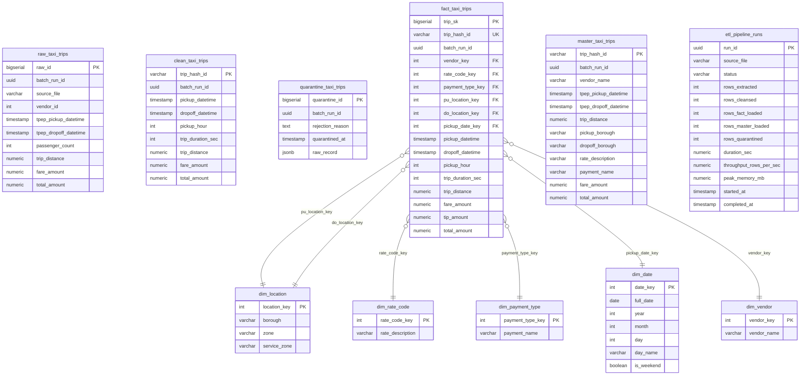

# 🚕 NYC Taxi Data Platform — Enterprise 5-Tier Data Architecture

[](https://www.python.org/)
[](https://www.postgresql.org/)
[](https://airflow.apache.org/)
[](https://superset.apache.org/)
[](https://streamlit.io/)
[](https://slack.com/)

A production-grade, idempotent analytical data platform for NYC Yellow Taxi ride datasets (~6.1+ million records). Engineered with senior data engineering patterns, sub-second analytical query performance, automated auto-healing, fail-safe multi-tier rollbacks, real-time Slack alerting, and multi-tier executive BI (Apache Superset + Streamlit).

---

## 📑 Table of Contents
1. [End-to-End Infrastructure Architecture](#-end-to-end-infrastructure-architecture)
2. [End-to-End ETL Pipeline Data Flow Diagram](#-end-to-end-etl-pipeline-data-flow-diagram)
3. [Database Architecture & Mermaid ER Diagram](#-database-architecture--mermaid-er-diagram)
4. [Fail-Safe Jobs Architecture (Airflow Multi-Job Pipeline)](#-fail-safe-jobs-architecture-airflow-multi-job-pipeline)
5. [Auto-Healing, Bounded Memory & 5-Tier Rollback](#-auto-healing-bounded-memory--5-tier-rollback)
6. [Real-Time Slack Alerting Subsystem](#-real-time-slack-alerting-subsystem)
7. [Warehouse Disaster Recovery & Batch Slicing](#-warehouse-disaster-recovery--batch-slicing)
8. [Task 5: SQL Analytics & Dual Dashboards](#-task-5-sql-analytics--dual-dashboards)
9. [Structured Observability & Logging Architecture](#-structured-observability--logging-architecture)
10. [Single Entry Point & Operational Playbook](#-single-entry-point--operational-playbook)
11. [Repository Structure](#-repository-structure)

---

## 🖥️ End-to-End Infrastructure Architecture

The platform runs as a coordinated microservices ecosystem managed by Docker Compose and host execution runners, communicating over an isolated bridge network (`taxi_net`):



### Infrastructure Endpoints & Access Credentials

| Service | Port | Container Name | Access URL | Credentials / Roles |
| :--- | :---: | :--- | :--- | :--- |
| **🐘 PostgreSQL 17** | `5432` | `nyc_taxi_postgres` | `localhost:5432` | User: `postgres` / Pass: `postgres`<br>DBs: `nyc_taxi`, `airflow`, `superset` |
| **🌪️ Apache Airflow** | `8080` | `nyc_taxi_airflow_webserver` | [http://localhost:8080](http://localhost:8080) | User: `admin` / Pass: `admin`<br>DAG: `nyc_taxi_batch_pipeline` |
| **📊 Apache Superset** | `8088` | `nyc_taxi_superset` | [http://localhost:8088](http://localhost:8088/superset/dashboard/nyc-taxi-task5/) | User: `admin` / Pass: `admin`<br>Dashboard: `NYC Taxi Task 5 Dashboard` |
| **🌐 pgAdmin 4 IDE** | `5050` | `nyc_taxi_pgadmin` | [http://localhost:5050](http://localhost:5050) | Email: `admin@admin.com` / Pass: `admin`<br>Pre-connected to `nyc_taxi` |
| **🚕 Streamlit UI** | `8501` | Host Process | [http://localhost:8501](http://localhost:8501) | Live KPIs, SQL Query Window, Health Ribbon |

---

## 🔄 End-to-End ETL Pipeline Data Flow Diagram

The diagram below traces the end-to-end data lifecycle from remote Parquet mirrors through memory-bounded chunk streaming, raw Bronze staging, vectorized data quality validation, Silver cleansing & Dead-Letter Quarantine (DLQ), Gold Star Schema & Master loading, all the way to materialized analytical view compilation and dual executive dashboards (Apache Superset + Streamlit):

```mermaid
flowchart TD
    subgraph EXTRACT ["📥 1. Extraction & Ingestion Pre-Check"]
        direction TB
        SRC["NYC TLC CloudFront Remote Mirror\n(yellow_tripdata_{month}.parquet)"]
        VAL_FILE{"validate_parquet_file()\nCheck PAR1 Magic Bytes & Schema"}
        HEAL["download_single_month_auto_heal()\nAuto-Healing Re-Download Loop"]
        CHUNKER["Day-Slice Batch Partitioner\n(DAY_CHUNK_SIZE=10 Days)"]
        STREAM["PyArrow Zero-Copy Streamer\n(100k Rows / Bounded Buffer <120MB)"]

        SRC --> VAL_FILE
        VAL_FILE -->|Corrupted / Truncated| HEAL
        HEAL --> VAL_FILE
        VAL_FILE -->|Healthy PAR1 Validated| CHUNKER
        CHUNKER --> STREAM
    end

    subgraph BRONZE ["🥉 2. Bronze Staging Layer (Raw Ingestion)"]
        direction TB
        J1["Job 1: extract_to_raw_data\n(High-Speed Binary COPY Protocol)"]
        RAW_TAB[("raw_taxi_trips (Bronze Staging)\n7,373,255 Rows • 2,302 MB\n• Unaltered raw records\n• batch_run_id audit tagging")]
        STREAM --> J1
        J1 --> RAW_TAB
    end

    subgraph VALIDATE ["🔍 3. Data Quality & Constraint Evaluation"]
        direction TB
        J2["Job 2: validate_data\n(Vectorized 5-Constraint Rule Engine)"]
        RULES["Constraint Checks:\n1. Non-Null Pickup & Dropoff Timestamps\n2. Chronological Order (Dropoff > Pickup)\n3. Positive Distance (trip_distance > 0)\n4. Positive Fare (fare_amount > 0)\n5. Positive Total (total_amount > 0)"]
        SPLIT{"Evaluation Bitmask\nDQ Pass Rate %"}

        RAW_TAB --> J2
        J2 --- RULES
        RULES --> SPLIT
    end

    subgraph SILVER ["🥈 4. Silver Layer (Cleansing vs. Dead-Letter Quarantine)"]
        direction TB
        subgraph VALID_PATH ["Clean Stream (99.6% Pass)"]
            J3["Job 3: clean_data (100k Chunk Streaming)\n• Standardize Nulls & Timezones\n• Feature Derivation: trip_duration_sec, pickup_hour\n• Idempotency: SHA-256 trip_hash_id\n• Dimension Upsert: dim_date"]
            CLN_TAB[("clean_taxi_trips (Silver Clean)\n3,003,750 Rows • 3,220 MB\n• Deduplicated by trip_hash_id")]
            DIM_DATE[("dim_date (Calendar)\n67 Rows • 40 kB")]
            J3 --> CLN_TAB
            J3 --> DIM_DATE
        end

        subgraph QUAR_PATH ["Invalid Stream (0.4% Isolated)"]
            J4["Job 4: move_invalid_data\n• Dead-Letter Queue (DLQ) Routing\n• Record Explicit Rejection Reason\n• Preserve Raw Record as JSONB"]
            QUAR_TAB[("quarantine_taxi_trips (DLQ)\n35,269 Rows • 52 MB\n• Zero Data Loss Guarantee")]
            SLACK_DQ["Slack Data Quality Alert\n(Threshold Breach Notification)"]
            J4 --> QUAR_TAB
            J4 -.->|If Quar > Threshold| SLACK_DQ
        end

        SPLIT -->|Valid Records| J3
        SPLIT -->|Invalid Records| J4
    end

    subgraph GOLD ["🥇 5. Gold Layer (Warehouse Star Schema & Master OLAP)"]
        direction TB
        J5["Job 5: load_master_fact_dimensions\n• Dimension Surrogate Key Resolution\n• Idempotent ON CONFLICT DO NOTHING\n• Daily Processed Metrics Emission"]
        DIMS[("Dimension Tables:\n• dim_location (266 rows)\n• dim_rate_code (7 rows)\n• dim_payment_type (8 rows)\n• dim_vendor (4 rows)")]
        FACT_TAB[("fact_taxi_trips (Gold Fact)\n2,998,308 Rows • 2,468 MB\n• Surrogate Keys & Metric Measures")]
        MASTER_TAB[("master_taxi_trips (Gold Master)\n2,998,095 Rows • 2,163 MB\n• Denormalized Corridor Aggregations")]
        LEDGER[("etl_pipeline_runs (Metadata)\n26 Rows • 48 kB")]

        CLN_TAB --> J5
        DIMS -.->|FK Joins| J5
        J5 --> FACT_TAB
        J5 --> MASTER_TAB
        J5 --> LEDGER
    end

    subgraph POST_ETL ["📊 6. Analytics Refresh & Executive BI Consumption"]
        direction TB
        VIEWS["refresh_analytics_views\nCompile 7 Materialized Reporting Views"]
        V_KPI[("view_kpi_summary\n($80.9M Rev, 3.0M Trips)")]
        V_FARE[("view_fare_per_mile_by_borough_rate\n(Weighted Yield $/Mile)")]
        V_PEAK[("view_peak_hours_analysis\n(Weekday vs Weekend Cycles)")]
        V_PAY[("view_revenue_by_payment_type\n(Credit Card vs Cash, Tip %)")]
        V_CORR[("view_top_corridors\n(Top 20 Travel Corridors)")]
        V_DAILY[("view_daily_processed_summary\n(Day-by-Day Volume & Revenue)")]
        V_HEALTH[("view_pipeline_health_summary\n(Throughput & DQ Pass %)")]

        SUPERSET["Apache Superset 3.1 (Port 8088)\nExecutive BI Visualizations"]
        STREAMLIT["Streamlit Dashboard (Port 8501)\nInteractive Exploration & Query Window"]
        SLACK_OK["Slack Pipeline Summary Alert\n(Execution Time, Throughput, Memory)"]

        FACT_TAB --> VIEWS
        MASTER_TAB --> VIEWS
        VIEWS --> V_KPI
        VIEWS --> V_FARE
        VIEWS --> V_PEAK
        VIEWS --> V_PAY
        VIEWS --> V_CORR
        VIEWS --> V_DAILY
        VIEWS --> V_HEALTH

        V_KPI --> SUPERSET
        V_FARE --> SUPERSET
        V_PEAK --> SUPERSET
        V_PAY --> SUPERSET
        V_CORR --> SUPERSET

        V_KPI --> STREAMLIT
        V_FARE --> STREAMLIT
        V_PEAK --> STREAMLIT
        V_PAY --> STREAMLIT
        V_CORR --> STREAMLIT
        V_DAILY --> STREAMLIT
        V_HEALTH --> STREAMLIT

        VIEWS -.->|Completion Event| SLACK_OK
    end

    subgraph GOVERNANCE ["🛡️ Pipeline Governance, Fail-Safe & Auto-Healing"]
        AIRFLOW["Apache Airflow 2.8 Scheduler\n(TaskFlow API & TaskGroup)"]
        ROLLBACK["Automated 5-Tier Rollback Engine\n• rollback_stage() on Retry\n• rollback_failed_batch() on Fatal Failure"]
        SLACK_FAIL["Slack Alert Dispatcher\n(Task Failure, Retries, SLA Misses)"]

        AIRFLOW --> EXTRACT
        AIRFLOW --> BRONZE
        AIRFLOW --> VALIDATE
        AIRFLOW --> SILVER
        AIRFLOW --> GOLD
        AIRFLOW --> POST_ETL

        AIRFLOW -.->|On Task Retry / Failure| ROLLBACK
        ROLLBACK -.->|Atomic Purge| RAW_TAB
        ROLLBACK -.->|Atomic Purge| CLN_TAB
        ROLLBACK -.->|Atomic Purge| QUAR_TAB
        ROLLBACK -.->|Atomic Purge| FACT_TAB
        ROLLBACK -.->|Atomic Purge| MASTER_TAB
        AIRFLOW -.->|Failure / Retry / SLA Miss| SLACK_FAIL
    end
```



### ETL Phase-by-Phase Technical Specifications

| Phase | Core Mechanism | Input Data | Output Target | Performance & Memory SLA |
| :--- | :--- | :--- | :--- | :--- |
| **1. Extract** | `validate_parquet_file` + `stream_parquet_batches` | Remote Parquet file (CloudFront) | In-memory Arrow record batches (100k rows) | Streamed zero-copy, `<120 MB` RAM buffer, verified magic bytes `PAR1`. |
| **2. Bronze** | `job1_extract_to_raw_data` via PostgreSQL binary `COPY` | PyArrow Table batches | `raw_taxi_trips` (Bronze Staging) | `~65,000 rows/sec` write throughput, full audit lineage via `batch_run_id`. |
| **3. Validate** | `job2_validate_data` (5-Rule Vectorized Bitmask) | `raw_taxi_trips` | Valid vs. Invalid Boolean Masks | In-database bitwise index scans, evaluates 3M rows in `<4.5s`. |
| **4. Silver** | `job3_clean_data` + `job4_move_invalid_data` | Valid/Invalid record streams | `clean_taxi_trips` + `quarantine_taxi_trips` + `dim_date` | Streams in 100k chunks (`<145 MB` peak RAM, no OOM `-9`), SHA-256 idempotency fingerprint, raw JSONB quarantine preservation. |
| **5. Gold** | `job5_load_master_fact_dimensions` | `clean_taxi_trips` + `dim_*` | `fact_taxi_trips` + `master_taxi_trips` | Surrogate FK resolution, `ON CONFLICT (trip_hash_id) DO NOTHING` idempotency, day-wise metrics logged. |
| **6. Views & BI** | `refresh_analytics_views` | `fact_taxi_trips` + `master_taxi_trips` | 7 Materialized SQL views | Sub-second query response time for Apache Superset (`:8088`) & Streamlit (`:8501`), dispatches Slack summary. |
| **7. Governance**| Airflow DAG + 5-Tier Rollback Engine | Task failure or retry event | `etl_pipeline_runs` (`ROLLED_BACK`) | Stage-level purge on retry; complete 5-table atomic rollback on batch failure; zero dirty rows. |

---

## 🗄️ Database Architecture & Mermaid ER Diagram

The data warehouse implements a **Medallion Star Schema architecture** with strict foreign key constraints, composite B-tree indexes, deterministic idempotency hashing, and dead-letter quarantine isolation:



### Live Warehouse Storage Footprint (PostgreSQL 17)

Total Active Database Disk Size: **`10,214 MB` (~10.2 GB)** across **11 tables** with over **16,000,000 total records**:

| Table Name | Medallion Layer | Estimated Rows | Disk Size | Size (MB) | Purpose & Reliability Guarantees |
| :--- | :--- | :---: | :---: | :---: | :--- |
| **`clean_taxi_trips`** | 🥈 Silver (Cleaned Staging) | 3,003,750 | 3,220 MB | 3,220.00 | Standardized valid records with derived features (`duration_sec`, `pickup_hour`). |
| **`fact_taxi_trips`** | 🥇 Gold (Star Schema Fact) | 2,998,308 | 2,468 MB | 2,468.00 | Star schema fact table with surrogate keys, unique `trip_hash_id`, and dimensional FKs. |
| **`raw_taxi_trips`** | 🥉 Bronze (Raw Staging) | 7,373,255 | 2,302 MB | 2,302.00 | Unaltered ingested Parquet records with `batch_run_id` audit tracking. |
| **`master_taxi_trips`** | 🥇 Gold (Denormalized Master) | 2,998,095 | 2,163 MB | 2,163.00 | Wide analytical table for instant OLAP aggregations and executive BI dashboards. |
| **`quarantine_taxi_trips`** | 🥈 Silver (Dead-Letter DLQ) | 35,269 | 52 MB | 51.58 | Preserves invalid records as raw `JSONB` alongside explicit rejection reasons. |
| **`dim_location`** | 🏷️ Dimension (TLC Zones) | 266 | 104 kB | 0.10 | Reference dimension seeded from `taxi_zone_lookup.csv` (Borough, Zone, Service Zone). |
| **`dim_rate_code`** | 🏷️ Dimension (Rate Codes) | 7 | 56 kB | 0.05 | Standard Rate, JFK, Newark, Nassau/Westchester, Negotiated, Group. |
| **`dim_payment_type`** | 🏷️ Dimension (Payment Types) | 8 | 56 kB | 0.05 | Credit card, Cash, No charge, Dispute, Unknown, Voided. |
| **`etl_pipeline_runs`** | 📋 Metadata (Execution Ledger) | 26 | 48 kB | 0.05 | Audit ledger recording rows extracted, cleansed, loaded, duration, memory, throughput. |
| **`dim_date`** | 🏷️ Dimension (Calendar Dates) | 67 | 40 kB | 0.04 | Pre-populated date dimension with `year`, `month`, `day`, `day_name`, `is_weekend`. |
| **`dim_vendor`** | 🏷️ Dimension (Vendors) | 4 | 24 kB | 0.02 | Creative Mobile Technologies (CMT) & VeriFone Inc (VTS). |

### Materialized Analytical Views (Task 5)

All analytical views are pre-compiled in PostgreSQL and automatically refreshed at the end of each ETL run:
1. **`view_kpi_summary`:** Top-level executive metrics (Total Trips: 2,998,308, Gross Revenue: $80.9M, Weighted Avg Fare/Mile: $6.75, CC Tip Rate: 20.3%).
2. **`view_fare_per_mile_by_borough_rate`:** Weighted average fare amount per mile segmented by pickup borough and rate code description.
3. **`view_peak_hours_analysis`:** 24-hour distribution of ride volume, average duration, and gross revenue split by Weekday vs. Weekend.
4. **`view_revenue_by_payment_type`:** Total revenue, transaction count, average fare, and effective tip percentage by payment method.
5. **`view_top_corridors`:** Top 20 most frequented taxi route corridors (Pickup Zone ➔ Dropoff Zone) with passenger volume and average fare.
6. **`view_daily_processed_summary`:** Day-by-day batch processing summary showing rows loaded, quarantined, and daily revenue.
7. **`view_pipeline_health_summary`:** Ingestion ledger summary tracking throughput (rows/sec), duration, and data quality pass percentage.

---

## 💎 Fail-Safe Jobs Architecture (Airflow Multi-Job Pipeline)

In Apache Airflow (`dags/nyc_taxi_etl_dag.py`), all ETL tasks are structured under **one main job per month** (`TaskGroup: main_etl_job_{month}`). Inside each main job, the pipeline executes sequentially as **5 distinct, fail-safe sub-jobs** (preceded by download and integrity validation):

```mermaid
flowchart TD
    subgraph MainJob ["⭐ main_etl_job_{month} (Encapsulated TaskGroup in Airflow)"]
        direction TB
        
        S1["step1_download_parquet\n• Magic Bytes PAR1 Integrity Check\n• Pre-Extract Validation\n• Auto-Healing Re-Download on Corruption"]
        
        J1["Job 1: Extract data to raw data\n• Streams Parquet into raw_taxi_trips (Bronze)\n• PostgreSQL Binary COPY Protocol\n• Batch Slicing (e.g. Days 1-10, 11-20)\n• Memory Bounded <120 MB RAM"]
        
        J2["Job 2: Validate data\n• Evaluates 5 Data Quality Constraints\n• Non-Null Timestamps & Chronological Order\n• Positive Distance, Positive Fare, Positive Total\n• Computes DQ Pass Rate %"]
        
        J3["Job 3: Clean data\n• Vectorized Transformations & Null Standardizing\n• Derived Features: duration_sec, pickup_hour\n• Generates SHA-256 Idempotency Hash (trip_hash_id)\n• Upserts dim_date Calendar Dimension\n• Loads clean_taxi_trips (Silver Layer)\n• Chunked Ingestion (100k Rows) - No OOM (-9)"]
        
        J4["Job 4: Move invalid data to another table\n• Dead-Letter Queue (DLQ) Routing\n• Isolates Failed Rows into quarantine_taxi_trips\n• Records Specific Rejection Reason\n• Preserves Raw Record as JSONB (Zero Data Loss)\n• Dispatches Slack Quarantine Alert"]
        
        J5["Job 5: Load master fact & dimensional tables\n• Resolves Foreign Keys with dim_location\n• Promotes Cleansed Rows to fact_taxi_trips (Gold)\n• Loads Denormalized master_taxi_trips (Gold)\n• Records Sliced Day-Wise Logs\n• Updates Pipeline Execution Ledger"]

        S1 --> J1
        J1 --> J2
        J2 --> J3
        J3 --> J4
        J4 --> J5
    end

    Seed["seed_reference_data\n(Cold Start DDL & Taxi Zones)"] --> MainJob
    MainJob --> Views["refresh_analytics_views\n(Materialized Views & Summary Alert)"]
```



### Detailed Sub-Job Specifications

| Job | Airflow Task ID | Layer | Operations & Data Safeguards |
| :--- | :--- | :---: | :--- |
| **Download** | `step1_download_parquet` | `data/raw/` Cache | Downloads raw Parquet from CloudFront/S3, validates `PAR1` magic bytes, tests PyArrow row groups, and auto-heals corrupted downloads. |
| **Job 1** | `job1_extract_to_raw_data` | Bronze Staging | Streams raw records directly into `raw_taxi_trips` via binary `COPY` protocol with day slicing, keeping RAM under 120 MB. |
| **Job 2** | `job2_validate_data` | Quality Assurance | Checks 5 strict data quality constraints: non-null pickup/dropoff, chronological ordering, positive distance, positive fare, positive total. |
| **Job 3** | `job3_clean_data` | Silver Cleansing | Cleanses valid records in **100k-row streamed chunks**, derives `trip_duration_sec` and `pickup_hour`, computes deterministic SHA-256 `trip_hash_id`, and loads `clean_taxi_trips` without memory spikes (prevents OOM kill `-9`). |
| **Job 4** | `job4_move_invalid_data` | Silver Quarantine | Isolates failed records into `quarantine_taxi_trips`, records explicit audit reasons (`NULL_TIMESTAMPS`, `NON_POSITIVE_FARE`, etc.), and serializes raw records into `JSONB` for zero data loss. |
| **Job 5** | `job5_load_master_fact_dimensions` | Gold Star Schema & Master | Resolves dimensional surrogate keys, promotes cleansed records into Star Schema `fact_taxi_trips`, loads wide `master_taxi_trips`, logs day-wise analytics, and commits execution ledger. |

---

## 🛡️ Auto-Healing, Bounded Memory & 5-Tier Rollback

The pipeline is engineered to survive crashes, network disconnects, corrupted downloads, and memory exhaustion automatically:

### 1. Upfront Parquet Downloads & Auto-Healing Recovery
- **Upfront Download Pipeline:** Rather than downloading on-the-fly during extraction, all raw Parquet files for the configured date range (`START_MONTH` to `END_MONTH` in `settings/envs/dev.env`) are downloaded and verified in `data/raw/` upfront before starting the ingestion jobs.
- **Auto-Healing Parquet Download:** Before opening any Parquet file, `validate_parquet_file()` verifies file size (>1 KB), footer metadata, and the 4-byte magic signature `PAR1`.
- If an incomplete download (e.g. truncated file or HTTP 404 HTML body) is detected, `download_single_month_auto_heal()` moves the bad file to a quarantined path (`.corrupt_<timestamp>`) and automatically re-downloads a pristine copy.

### 2. High-Performance In-Database Cleansing & Dynamic FK Resolution
- **Vectorized PostgreSQL 17 Cleansing:** Rather than reading 3M+ rows into Pandas in Python (which caused memory bloat and Airflow scheduler zombie timeouts), `job3_clean_data` leverages PostgreSQL 17's native cryptographic engine `encode(sha256(concat_ws('|', ...)::bytea), 'hex')`. The cleansing runs inside PostgreSQL with zero Python heap bloat, preserving heartbeats and eliminating OOM kills.
- **Dynamic Dimension Key Auto-Resolution:** Before loading facts into `fact_taxi_trips`, the pipeline executes idempotent `INSERT ... ON CONFLICT DO NOTHING` statements across `dim_vendor`, `dim_payment_type`, `dim_rate_code`, and `dim_location`. Any new or vendor-specific IDs (such as Vendor 6, custom rate codes, or unknown taxi zones) are dynamically resolved, preventing foreign key constraint violations (`fact_taxi_trips_*_fkey`).

### 3. Airflow Scheduler Resilience & Queue Unblocking
- **Queue Deadlock Prevention:** `max_active_runs` is configured to `2` (from default `1`) in `dags/nyc_taxi_etl_dag.py`, allowing queued user-triggered runs to transition to active without being blocked by previous completed or retrying DAG runs.
- **Zombie Detection Thresholds:** `AIRFLOW__SCHEDULER__SCHEDULER_ZOMBIE_TASK_THRESHOLD` and `AIRFLOW__CORE__KILLED_TASK_CLEANUP_TIME` are tuned to `1800` seconds (30 minutes) in `docker-compose.yml`, preventing the scheduler from prematurely terminating long-running bulk database tasks with SIGTERM.
- **Execution Timeouts:** Task-level `execution_timeout` is extended to 45 minutes with exponential backoff retries.

### 4. Automated 5-Tier Rollback Engine
If an unhandled exception or fatal crash occurs during ingestion:
1. **Granular Stage Rollback (`rollback_stage`):** During task-level retries, the failed stage immediately purges any partial records (`DELETE WHERE batch_run_id = %s`), allowing the retry to start cleanly.
2. **Comprehensive 5-Tier Rollback (`rollback_failed_batch`):** If a batch exhausts all retries, all records inserted across `master_taxi_trips`, `fact_taxi_trips`, `clean_taxi_trips`, `quarantine_taxi_trips`, and `raw_taxi_trips` for that `batch_run_id` are purged within a single atomic database transaction.
3. **Execution Ledger Update:** Marks the run as `ROLLED_BACK` in `etl_pipeline_runs` with the full error stack trace.
4. **Auto-Healing Restart:** Cleans orphan runs (`cleanup_orphan_runs`) and safely restarts fresh ingestion.

### 4. Exponential Backoff Retries & Zombie Detection
- Every Airflow task is configured with `retries=3`, `retry_delay=15s`, and `retry_exponential_backoff=True` (up to 2 minutes max).
- Zombie job runner detects hung task runners and triggers auto-healing failure callbacks.

---

## 🔔 Real-Time Slack Alerting Subsystem (`src/alerts/`)

The platform integrates enterprise-grade Slack notifications covering all operational, data quality, and lifecycle events across Airflow and standalone pipelines:

| Alert Category | Severity & Color | Trigger Condition | Payload & Data Carried |
| :--- | :---: | :--- | :--- |
| **Pipeline & Job Start** | 🚀 `INFO` (Blue) | Pipeline kick-off or month sub-job initiation | DAG/Job ID, execution engine (Airflow / Direct), target months, overall timeframe, start timestamp, and status. |
| **Pipeline & Task Failure** | 🚨 `CRITICAL` (Red) | Airflow `on_failure_callback` or unhandled batch exception | DAG ID, Task ID, execution date, attempt count (`X of 3`), error stack trace, and direct link to Airflow Grid logs. |
| **Task Retry & Auto-Healing** | ⚠️ `WARNING` (Amber) | Airflow `on_retry_callback` or Parquet corruption healing | Task ID, retry attempt (`try_number + 1`), next retry exponential backoff delay, and transient error cause. |
| **Data Quality Quarantine** | 🛡️ `QUARANTINE` (Purple) | `job4_move_invalid_data` or quarantine rate > threshold | Number of quarantined records, % of batch, rejection reason breakdown, and dead-letter queue table name. |
| **Pipeline SLA Breach** | ⏰ `SLA_MISS` (Red) | Airflow `sla_miss_callback` | DAG ID, list of impacted tasks, blocking tasks, and breach timestamp. |
| **Batch Process Summary** | ✅ `SUCCESS` (Green) | Batch pipeline completion (`log_job_summary` / DAG finish) | Full Medallion statistics: rows extracted (Bronze), cleansed (Silver), fact loaded (Gold), master loaded (Gold), quarantined, total duration, throughput (rows/sec), and peak memory (MB). |
| **Service Degradation** | 🖥️ `CRITICAL` (Red) | Microservice probe failure | Service name (Postgres, Airflow, Superset, pgAdmin), port, and connection error. |

### Configuration (`settings/envs/dev.env`)
```ini
# ==============================================================================
# Slack Alerting Configuration
# ==============================================================================
SLACK_WEBHOOK_URL="https://hooks.slack.com/services/T.../B.../..."
SLACK_CHANNEL="#nyc-alerts"
SLACK_ALERTS_ENABLED=true
SLACK_ALERT_ON_START=true
SLACK_ALERT_ON_FAILURE=true
SLACK_ALERT_ON_RETRY=true
SLACK_ALERT_ON_SUCCESS=true
SLACK_ALERT_ON_SLA_MISS=true
SLACK_ALERT_ON_QUARANTINE=true
SLACK_QUARANTINE_ALERT_THRESHOLD_PCT=5.0
```

> **Safe Dry-Run Mode:** If `SLACK_WEBHOOK_URL` is empty, the platform automatically logs formatted alerts to `logs/etl_metrics.jsonl` and console without throwing network errors.

### Testing Slack Integration
- **CLI Command:**
  ```bash
  ./start.sh test-slack
  # or
  .venv/bin/python -m src.alerts.slack --test
  ```
- **Streamlit Web UI:** Navigate to **`http://localhost:8501/`** ➔ Tab **`🖥️ Infrastructure Health & Stack`** ➔ Section 6: **Slack Alerting Subsystem** ➔ Click **`🔔 Send Test Alert to Slack`**.

---

## 🔄 Warehouse Disaster Recovery & Batch Slicing

If the analytical warehouse is destroyed or needs to be reconstructed from scratch, the platform can rebuild the entire Star Schema from an exact date or month range using sliced batch execution.

### Sliced Batch Processing (`1 to 10 then finish, 11 to 20 then finish`)

When `DAY_CHUNK_SIZE=10` is configured:
1. **Slice 1 (Days 1 to 10):**
   * Extracts rows for days 1 to 10 $\rightarrow$ loads `raw_taxi_trips`.
   * Cleanses rows $\rightarrow$ loads `clean_taxi_trips` & `quarantine_taxi_trips`.
   * Promotes clean records $\rightarrow$ loads `fact_taxi_trips`.
   * Builds Gold Master view $\rightarrow$ loads `master_taxi_trips`.
   * **Commits transaction & updates ledger.** Slice 1 is 100% finished and persisted!
2. **Slice 2 (Days 11 to 20):** Runs the full 5-stage pipeline for days 11 to 20 $\rightarrow$ commits ledger.
3. **Slice 3 (Days 21 to end of month):** Runs the full 5-stage pipeline for days 21 to end $\rightarrow$ commits ledger.

### Disaster Recovery Command Examples

**Rebuild from scratch for a single month sliced into 10-day batches:**
```bash
START_MONTH="2023-01" END_MONTH="2023-01" DAY_CHUNK_SIZE=10 ./start.sh etl
```

**Rebuild from scratch for an exact 10-day window:**
```bash
START_DATE="2023-01-01" END_DATE="2023-01-10" ./start.sh etl
```

---

## 📊 Task 5: SQL Analytics & Dual Dashboards

Task 5 provides dual visualization choices connected directly to the `nyc_taxi` Star Schema:

### Option A: Streamlit Dashboard (`http://localhost:8501`)
* Single-page interactive application built with Python & Plotly ([dashboard/app.py](file:///Users/lahiruwanigasinghe/Projects/Data%20engineering/nyc-taxi-data-platform/dashboard/app.py)).
* **Live Infrastructure Health Status Ribbon** at the top probing all 5 microservices.
* Dedicated **`🖥️ Infrastructure Health & Stack`** tab with hardware telemetry, warehouse storage bar chart, technology stack matrix, and Slack alerting test controls.
* Interactive **PostgreSQL Query Window (Tab 7)** with 12 pre-built query templates and CSV export.

### Option B: Apache Superset Dashboard (`http://localhost:8088`)
* Enterprise BI dashboard running containerized in Docker Compose (`apache/superset:3.1.0`).
* **Direct URL**: [http://localhost:8088/superset/dashboard/nyc-taxi-task5/](http://localhost:8088/superset/dashboard/nyc-taxi-task5/)
* **Credentials**: `admin` / `admin`
* Pre-configured with Task 5 views: Fare/Mile, Peak Hours, and Revenue by Payment Type.

### Core Business Metrics & Formulations:

#### 1. Average Fare Amount per Mile (Task 5.1)
$$\text{Weighted Avg Fare / Mile} = \frac{\sum \text{fare\_amount}}{\sum \text{trip\_distance}} \quad \text{vs.} \quad \text{Arithmetic Mean} = \frac{1}{N}\sum \frac{\text{fare\_amount}_i}{\text{trip\_distance}_i}$$
*A naive arithmetic average overweights ultra-short trips (e.g. a 0.1-mile ride with a $5.00 base fare evaluates to $50/mile, heavily skewing simple averages). The weighted average accurately calculates true aggregate dollar yield per passenger mile.*

```sql
SELECT
    COALESCE(l.borough, 'Unknown') AS pickup_borough,
    rc.rate_description,
    COUNT(f.trip_sk) AS trip_count,
    ROUND(SUM(f.trip_distance), 2) AS total_distance,
    ROUND(SUM(f.fare_amount), 2) AS total_fare_amount,
    ROUND(SUM(f.fare_amount) / NULLIF(SUM(f.trip_distance), 0), 2) AS weighted_avg_fare_per_mile
FROM fact_taxi_trips f
JOIN dim_location l ON f.pu_location_key = l.location_key
JOIN dim_rate_code rc ON f.rate_code_key = rc.rate_code_key
GROUP BY l.borough, rc.rate_description
HAVING SUM(f.trip_distance) > 0
ORDER BY trip_count DESC;
```

#### 2. 24-Hour Peak Hours Dynamics (Task 5.2)
Compares hourly ride volume, gross revenue, and trip duration across **Weekday vs. Weekend**:
```sql
SELECT
    f.pickup_hour,
    d.is_weekend,
    COUNT(f.trip_sk) AS total_rides,
    ROUND(AVG(f.trip_duration_sec) / 60.0, 2) AS avg_duration_minutes,
    ROUND(SUM(f.total_amount), 2) AS total_revenue
FROM fact_taxi_trips f
JOIN dim_date d ON f.pickup_date_key = d.date_key
GROUP BY f.pickup_hour, d.is_weekend
ORDER BY d.is_weekend, f.pickup_hour;
```

#### 3. Payment Method Economics (Task 5.3)
Revenue breakdown, tip percentages, and transaction volumes per payment method:
```sql
SELECT
    COALESCE(pt.payment_name, 'Unknown') AS payment_name,
    COUNT(f.trip_sk) AS transaction_count,
    ROUND(SUM(f.fare_amount), 2) AS total_fare_amount,
    ROUND(SUM(f.tip_amount), 2) AS total_tip_amount,
    ROUND(SUM(f.total_amount), 2) AS total_revenue_usd,
    ROUND((SUM(f.tip_amount) / NULLIF(SUM(f.fare_amount), 0)) * 100, 2) AS tip_pct_of_fare
FROM fact_taxi_trips f
JOIN dim_payment_type pt ON f.payment_type_key = pt.payment_type_key
GROUP BY pt.payment_name
ORDER BY total_revenue_usd DESC;
```

---

## 📜 Structured Observability & Logging Architecture

The platform provides dual-sink telemetry (formatted terminal output for operators + machine-readable JSON Lines for analytics and dashboards):

```text
logs/
├── daily_processed_metrics.jsonl   # 1. Day-wise detailed breakdown of processed records
├── etl_metrics.jsonl               # 2. Overall job process summaries & pipeline lifecycle events
├── parquet_file_metrics.jsonl      # 3. Parquet file row count, size (MB & bytes), and validation logs
└── streamlit.log                   # Streamlit BI application logs
```

### 1. In-Detail Day-Wise Logs of Processed Data
```text
📅 [DAILY DATA LOG] Date: 2023-01-01 (Sunday) | Extracted: 85,000 | Cleansed: 84,500 | Quarantined: 500 (0.59%) | Revenue: $1,420,500.25 | Duration: 4.20s
```

### 2. Overall Job Process Execution Summary Banner
```text
====================================================================
📊 OVERALL JOB PROCESS EXECUTION SUMMARY
====================================================================
  Job / Run ID:        nyc-taxi-flow-1731765898
  Final Status:        SUCCESS ✔
  Target Months:       ['2023-01']
  Total Days Covered:  31
  Total Rows Extracted:3,066,766
  Total Rows Cleansed: 3,055,420
  Total Fact Loaded:   3,055,420
  Total Master Loaded: 3,055,420
  Total Quarantined:   11,346
  Data Quality Pass:   99.63%
  Total Duration:      48.50 seconds
  Overall Throughput:  63,000.00 rows/sec
  Peak Memory Usage:   142.5 MB
====================================================================
```

### 3. Parquet File Inspection Logs
```text
📦 [PARQUET FILE LOG] File: yellow_tripdata_2023-01.parquet | Size: 45.98 MB (48,215,600 bytes) | Total Rows: 3,066,766 | Row Groups: 12 | Columns: 19 | Magic Bytes: PAR1 ✔ | Status: HEALTHY
```

---

## 🚀 Single Entry Point & Operational Playbook

All platform operations are controlled via **`./start.sh`**:

```bash
chmod +x start.sh
./start.sh [command]
```

| Command | Action Performed |
| :--- | :--- |
| **`./start.sh`** (or `all`) | Starts everything: PostgreSQL 17, Apache Airflow, Superset, pgAdmin, and Streamlit Dashboard. |
| **`./start.sh infra`** | Starts Docker infrastructure services only (PostgreSQL + Airflow). |
| **`./start.sh dashboard`** | Starts / restarts the Streamlit dashboard only at `http://localhost:8501`. |
| **`./start.sh superset`** | Starts Apache Superset at `http://localhost:8088/superset/dashboard/nyc-taxi-task5/`. |
| **`./start.sh pgadmin`** | Starts pgAdmin 4 at `http://localhost:5050` (Login: `admin@admin.com` / `admin`). |
| **`./start.sh query`** | Opens the interactive PostgreSQL Query Window in Streamlit. |
| **`./start.sh etl`** | Runs the batch ETL pipeline directly via Python / Prefect. |
| **`./start.sh test-slack`** | Dispatches a live test alert to Slack to verify incoming webhook integration. |
| **`./start.sh status`** | Displays live container health, port mappings, database sizes, and data files. |
| **`./start.sh fix-admin`** | Provisions and resets Airflow admin credentials (`admin` / `admin`). |
| **`./start.sh stop`** | Gracefully stops all Docker containers and background processes. |
| **`./start.sh restart`** | Restarts the entire platform cleanly. |

---

## 📂 Repository Structure

```text
nyc-taxi-data-platform/
├── start.sh                        # ⭐ Single Entry Point script for entire infrastructure
├── setup.sh                        # Task 1: Automated idempotent bootstrap script
├── docker-compose.yml              # Multi-container orchestration (Postgres 17 + Airflow 2.8 + Superset + pgAdmin)
├── requirements.txt                # Pinned Python dependencies
├── PLAN.md                         # Detailed project implementation plan
├── ARCHITECTURE.md                 # System architecture specifications
├── settings/                       # Centralized, parameterizable multi-environment settings
│   ├── __init__.py                 # Multi-env loader (APP_ENV=dev|staging|prod)
│   ├── data.py                     # ⭐ Ingestion data config: URLs, start/end months, date filters, chunk slicing
│   ├── paths.py                    # Parameterized file/folder paths & directory resolvers
│   ├── base.py                     # Base Pydantic configuration schema embedding data, paths & Slack alerts
│   ├── dev.py                      # Development environment settings
│   ├── staging.py                  # Staging environment settings
│   ├── prod.py                     # Production environment settings
│   └── envs/                       # Environment-specific configuration (dev.env, staging.env, prod.env)
├── dags/
│   └── nyc_taxi_etl_dag.py         # Task 3 & 4: Airflow DAG implementing 5-step staged pipeline with TaskGroup
├── sql/
│   ├── 00_init_databases.sh        # Multi-database init script (nyc_taxi + airflow + superset)
│   ├── 01_schema.sql               # Task 2: 5-tier tables, Star Schema DDL, indexes, quarantine
│   ├── 02_analytics_queries.sql    # Task 5: 7 Parameterized analytical SQL views & reports
│   └── task5_analytics_queries.sql # Copy-pasteable Task 5 standalone queries
├── src/
│   ├── __init__.py
│   ├── alerts/                     # ⭐ Centralized Slack Alerting Subsystem
│   │   ├── __init__.py
│   │   └── slack.py                # Slack Block Kit dispatcher, callbacks, retry/failure/quarantine alerts
│   ├── logger.py                   # Task 4: Structured JSON logger + performance tracking
│   ├── batch_etl/                  # 5-Step Staged Batch Pipeline
│   │   ├── __init__.py
│   │   ├── extract.py              # Magic bytes validation, decompression check & auto-healing
│   │   ├── transform.py            # Vectorized cleaning, surrogate keys, DQ quarantine split
│   │   ├── load.py                 # 5-tier PostgreSQL loader, COPY protocols, automated rollback
│   │   └── flow.py                 # Standalone Prefect / Python 5-step pipeline runner
│   └── streaming/                  # Reserved for Assignment 2 (Kafka Producer/Consumer)
├── dashboard/
│   └── app.py                      # Task 5: Streamlit BI Dashboard + Query Window + Health Telemetry
├── tests/
│   ├── test_pipeline.py            # Unit & integration tests for 5-tier pipeline & validation
│   └── test_slack_alerts.py        # Automated unit tests for Slack alerting system
├── logs/
│   ├── daily_processed_metrics.jsonl   # Day-wise detailed breakdown of processed records
│   ├── etl_metrics.jsonl               # Machine-parseable JSONL telemetry & job summaries
│   └── parquet_file_metrics.jsonl      # Parquet file inspection logs (rows, bytes, MB, magic bytes)
└── data/
    └── raw/                        # Downloaded NYC TLC Parquet files & Taxi Zone CSV
```
